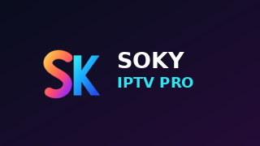

<p align="center">
  
</p>

# Soky IPTV Pro

**A premium IPTV player for Android TV, Google TV, Fire TV and Android phones.**

TV-first navigation · Live TV · Movies · Series · Resume & Continue Watching · EPG · Recording · Private local backups

> **Bring your own legal content.** Soky IPTV Pro is a player only. It does not supply IPTV subscriptions, copyrighted streams, playlists, server logins or TV channels.

## What makes Soky IPTV Pro different?

- **Built for the TV remote:** full D-pad navigation, predictable focus highlights, keyboard only after OK, fast screen transitions and native Android TV launcher support.
- **Live TV and EPG:** categories, guide navigation, channel previews, favourites, schedule and optional recordings.
- **Movies and series:** local and indexed provider catalogues, multilingual title search, metadata, trailers, film details, season/episode selection and artwork.
- **Independent catalogue refresh:** separate home-card refresh controls, accurate last-successful-update timestamps for Live TV, Movies and Series. Continue browsing while a catalogue updates.
- **Reliable native playback:** LibVLC-based VOD playback, seek bar and transport controls, subtitles/audio selection, device wake recovery and TV-centric fullscreen controls.
- **Continue Watching:** per-profile watched position, resume minutes and percentage, latest episode and automatic next-episode continuation.
- **Cast and discovery:** optional TMDB cast information, person search across your own imported titles, cached metadata and thumbnails.
- **Convenient source setup:** Xtream Codes, M3U and Stalker support, login validation and phone-assisted setup on the local network.
- **Backup and restore:** password-protected provider credential backup, TV-friendly restore and optional local/NAS synchronisation (currently paused in the gold build).
- **Settings and accessibility:** multiple languages, selected OS keyboard, parental controls, sync settings (currently paused), robust Back-key handling and TV/phone UI.

## Screens and branding

The S/K logo, adaptive icon, phone launcher icon, TV banner and splash artwork are stored under `app/src/main/res`. The colour palette is coral, cyan, blue and midnight.

## Download, install and test

The **current user-approved gold-standard development baseline** is **[Soky IPTV Pro v0.1.11.59](https://github.com/zenzehar/Koky-Sosy-player/releases/tag/v0.1.11.59-duration-persistence-ts-mkv-scan)** ([direct version-numbered APK](https://github.com/zenzehar/Koky-Sosy-player/releases/download/v0.1.11.59-duration-persistence-ts-mkv-scan/Soky_IPTV_Pro_v0.1.11.59.apk)). This is the user's latest accepted **development checkpoint**, based on the exact released commit `3ca3c0ae5d08143fdbe19b351a6f5168d64243b5`; it is **not production-signed, independently security-certified, or a guarantee of crash-free playback**. Earlier emulator-oriented diagnostic builds remain withdrawn from the recommended download path; never use test APKs with embedded credentials.

**Important for existing testers:** This full rebrand changes the Android package identity to `tv.sokyiptv.pro`, and therefore installs separately from earlier versions. Before installing, export and verify an encrypted provider login backup from the previous app. Copying providers or viewing history across package identities requires an explicit migration or import; it does not happen automatically.

## TV remote controls

| Input | Behaviour |
|---|---|
| D-pad | Navigate between cards, catalogue sections, refresh bars and player controls |
| OK | Open focused content, activate buttons, or enter text editing |
| Long OK / Menu | Open contextual actions on supported items |
| Back | Dismiss keyboard/controls, then return to the previous screen |
| VOD Up/Down | Autoplay → playback buttons → timeline, one step per level |

## Build from source

Requires JDK 17 and a configured Android SDK.

```sh
./gradlew :app:testDebugUnitTest :app:assembleDebug
```

The debug APK appears in `app/build/outputs/apk/debug/`. A production release requires a permanent keystore and explicit release-signing configuration. Do not ship a debug-signed release as 1.0.

## Privacy and licensing

The player stores IPTV details on your device. It does not require a central subscription service. Optional third-party metadata or add-on services use their own terms and privacy policies. LAN / NAS and Google Drive watch-history sync code remains in the repository but **all history synchronization is temporarily disabled in the v0.1.11.59 gold baseline** for playback-stability isolation. Local Continue Watching and position saving remain active; existing account data and cloud history have not been deleted.

This source distribution includes GPL-licensed material and must preserve applicable copyright and licence obligations. See [LICENSE](LICENSE), [third-party notices](docs/THIRD_PARTY_NOTICES.md), [Privacy](docs/PRIVACY.md) and [Release information](docs/RELEASING.md).

## Development status

**Current user-approved gold standard: [Soky IPTV Pro v0.1.11.59](https://github.com/zenzehar/Koky-Sosy-player/releases/tag/v0.1.11.59-duration-persistence-ts-mkv-scan)**, pinned to golden checkpoint branch [`milestone/v0.1.11.59-soky-iptv-pro-golden`](https://github.com/zenzehar/Koky-Sosy-player/tree/milestone/v0.1.11.59-soky-iptv-pro-golden), at exact released commit `3ca3c0ae5d08143fdbe19b351a6f5168d64243b5`. Its [GitHub Actions CI tests, assembly and publishing](https://github.com/zenzehar/Koky-Sosy-player/actions/runs/40320074265) passed. Start all future development on a **separate branch from this commit**; never modify the golden branch, released APK or tag without a new explicit user decision.

**Scope of v59 golden:** the v54 accepted native VLC playback/Back stabilization, Fire TV launcher fixes, translucent timer, corrected Continue Watching card, and disabled Google Drive/LAN/NAS history sync, plus isolated v56 catalogue/Room/EPG optimizations, v57 provider/played-episode runtime display, v58 serial bounded episode-duration exploration, and v59 MP4/HLS/MKV/TS metadata inspection, visible scan statuses and duration-hint retention across Reset Progress. Provider range-request restrictions and unsupported formats can still prevent duration discovery; do not represent the scan as universally successful. **Do not claim physical-device stress-test/benchmark or production security certification based on green CI.** v0.1.11.54 and v0.1.11.12 older golden checkpoints remain preserved for rollback and historical reference. The `main` branch is the public repository/docs landing branch, **not** the gold application-source branch.
